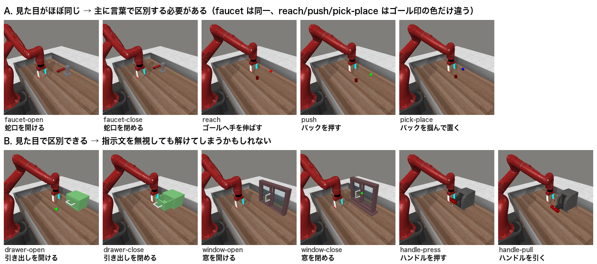
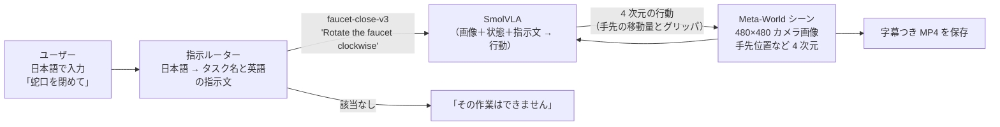

# 最終課題 企画書（案）

## その指示、ほんとうに聞いてる？
### M1 Mac で動く VLA（SmolVLA × Meta-World）に日本語で指示し、「言葉の効き目」を確かめる

---

## 0. ひとことで

- **やること**：Mac（M1）のローカル環境で、学習済み VLA「SmolVLA」をシミュレータ「Meta-World」で動かします。ターミナルに **日本語で指示**（例：「蛇口を閉めて」）を打つと、ロボットアームがその作業を実行します。
- **問い**：VLA は本当に「言葉」を見て動いているのか。それとも、**見た目だけで作業を決めていて指示文は無視している**のか。
- **確かめ方**：初期状態が **見た目上ほぼ同じで、言葉でしか区別できないタスクの組**（蛇口を「開ける／閉める」）と、**見た目で区別できる組**（引き出しを「開ける／閉める」）を用意します。それぞれで指示文だけを入れ替え、成功率がどう変わるかを比べます。
- **学習は不要で、推論だけで成立します**（課題要件「推論のみでも可」に合致）。Docker も GPU も使わず、`uv` だけで環境を作れます。



*図：Meta-World の初期シーン（M1 Mac 上でレンダリング）。上段の faucet-open と faucet-close は見た目がほぼ同一で（違うのは蛇口を置く範囲の広さだけ）、どちらの作業かは指示文でしか分からない。下段は引き出しや窓の状態を見れば作業が分かる。*

---

## 1. 課題要件との対応

| 要件（10/19 版 PDF） | 本企画での対応 |
|---|---|
| ロボットがタスクを実行する動画（1〜3分、倍速可） | 日本語の指示 → ロボットが実行、のデモ ＋ 入れ替えテストのハイライト（約2分） |
| 使用したコード一式（GitHub public） | `uv` プロジェクト一式（`pyproject.toml` / `uv.lock` / スクリプト） |
| 簡単なレポート（PDF） | 目的・構成・工夫・実験結果（表）・考察 |
| AI の活用（推論のみ可） | **VLA（SmolVLA）による画像＋言語 → 行動の推論**。加点として日本語文埋め込みによる指示ルーター |
| 使用ツール（ROS/Gazebo/Genesis 想定、他ツール可） | MuJoCo ベースの Meta-World ＋ LeRobot（「他のツールの使用も可」の範囲） |
| 締切：**2026/11/02（月）AM10:00** | 11/01（日）中の提出を目標にスケジュールを組む（§7） |

---

## 2. 何をするか

### 2.1 デモ（必須：ここまでで合格ライン）



1. ターミナルで日本語の指示を受け取ります。
2. **指示ルーター**が「どのタスクか」と「VLA に渡す英語の定型文」を決めます。該当するタスクがなければ実行せず「できません」と返します（安全側の設計）。
3. SmolVLA が毎ステップ、カメラ画像・ロボットの状態・指示文から行動を出力します（50 ステップ分をまとめて予測する action chunk 方式）。
4. 実行の様子を、日本語の指示と英語の指示文を字幕に入れて MP4 に保存します。

**見せ場**：faucet のシーンを固定したまま「開けて」「閉めて」と言い分けると、ロボットが**逆向きに**蛇口を回す（言葉が効いている）ところを見せます。

### 2.2 検証実験「言葉の入れ替えテスト」（加点：創造性・技術力）

**仮説**
- H1：見た目で区別できる組（引き出し・窓）では、VLA は指示文を**無視しても**成功してしまう。
- H2：見た目が同じ組（蛇口）では、指示文を入れ替えると成功率が大きく下がる（言葉を使っている）。
- H3：日本語の文をそのまま渡すと失敗が増える。学習時の英語の定型文以外は理解しにくいため。

**実験 1：2×2 の入れ替え表**（組ごとに作る）

| シーン ＼ 渡す指示文 | 「開けて」の定型文 | 「閉めて」の定型文 |
|---|---|---|
| faucet-open のシーン | 本来の成功率 | **言われていないのに成功した率** |
| faucet-close のシーン | **言われていないのに成功した率** | 本来の成功率 |

- **対角成分が高く非対角成分が低い**なら、「言葉を聞いている」と言えます。
- 非対角成分も高いなら、「見た目だけで動いている」ことになります。
- 対象とする組：faucet（見た目が同一）、drawer・window（見た目で区別可）。余裕があれば reach / push / pick-place の 3×3 も作ります（ゴール印の色だけが違う、中間的なケース）。
- 蛇口では、成功率に加えて**ハンドルの回転角**も記録します。成功判定に届かなくても「どちらに回そうとしたか」が分かり、言葉の効き目をより細かく測れます（§4.1）。

**実験 2：指示文のバリエーション**（各シーンの本来のタスクで成功率を測る）

| 条件 | 例（faucet-close のシーン） |
|---|---|
| 正しい定型文 | `Rotate the faucet clockwise` |
| 英語の言い換え | `Turn off the tap` |
| 日本語をそのまま | `蛇口を閉めて` |
| 無関係な文 | `Dunk the basketball into the basket` |
| 空文字 | `""` |
| ルーター経由（日本語 → 定型文） | `蛇口を閉めて` → `Rotate the faucet clockwise` |

- 各セルは **N=20 エピソード**（予備実験で 1 話 2〜10 秒と分かったため。§4.1）。**条件間で同じ seed の並びを使う**ことで、物体配置の運の差をなくして公平に比べます（reset の前に `np.random.seed(seed)` が必要。§6.2）。
- 結果は CSV に記録し、表とヒートマップにします。

**実験 3（予備実験を受けて追加）：ゴール印を消した蛇口の 2×2**

- 蛇口の 2 シーンは、ゴール印（小さな緑・青の点）の位置だけが違います（§4.1）。実験 1 の蛇口の組を、ゴール印を透明にして回し直します。
- 結果が実験 1 と変わらなければ、VLA は印ではなく**言葉**で向きを決めていると言えます。

> **実装済み（10/29）**：`src/kotoba_vla/experiment.py`。実験 1〜3 の 34 条件を N=20 で回すと、重複を除いて 560 話・約 65 分です。
>
> ```bash
> uv run python -m kotoba_vla.experiment --dry-run        # 条件と所要時間の見積もりだけ表示
> uv run python -m kotoba_vla.experiment                  # 本番（N=20）。止めても、もう一度実行すれば続きから
> uv run python -m kotoba_vla.experiment --summary-only   # 集計だけやり直す
> ```
>
> - 記録は 1 話 1 行で `results/episodes.csv` に追記し、条件ごとの集計は `results/summary.csv` に書き出します。
> - 集計には、本来の定型文との差の検定（Fisher の正確確率検定、両側）の p 値も入ります。
> - シーン・指示文・seed・ゴール印の有無が同じエピソードは再実行しません。そのため、実験 2 の定型文とルーター経由は実験 1 の結果を使い回します。
> - 実験 2 のシーンは、定型文での成功率が高い faucet-open・drawer-close・window-close です。言い換えはそれぞれ `Turn on the tap`・`Shut the drawer`・`Shut the window` にしました。

### 2.3 発展（余裕があれば、どれか1つ）

- **ルーターの AI 化**：キーワード辞書版から、日本語文埋め込み（例：`cl-nagoya/ruri-v3-130m`）による類似度検索版へ。類似度が閾値未満なら実行を拒否します。
- **dora-rs でノード化**（応用1 第6回の発展）：`入力ノード → ルーター → VLA → シミュレータ` を dataflow として yaml で配線します（§11 案 H）。
- **音声入力**：Mac 向けの Whisper 実装で、声で指示できるようにします（§11 案 B）。
- **推論速度の計測**：M1（MPS）と CPU で 1 チャンクあたりの推論時間を比べ、`num_steps`（Flow Matching のステップ数）を減らしたときの速度と成功率のトレードオフを調べます（§11 案 F）。

---

## 3. 講座の演習・課題サンプルとの差分

| | 基礎 第1回 演習 | 基礎 最終課題 | 応用1 第4・5回 | PDF のサンプル（自然言語操作系） | **本企画** |
|---|---|---|---|---|---|
| 実行環境 | Colab（GPU） | Colab（GPU） | Docker ＋ pixi | ROS / クラウド API | **M1 Mac ローカル・uv・Docker なし** |
| シミュレータ | LIBERO | LIBERO-plus | Gazebo（CRANE+ V2） | Gazebo など | **Meta-World（Sawyer アーム）** |
| モデル | SmolVLA（LIBERO 学習済み） | 自作 SmolVLA / LoRA | ACT（言語入力なし） | LLM / VLM（クラウド） | **SmolVLA（Meta-World 学習済み）** |
| 言語の扱い | 固定の英語指示でベンチマーク評価 | 固定の英語指示で学習・評価 | なし | 自然言語 → 指令への変換 | **日本語の自由入力 ＋ 「言葉の効き目」の検証** |
| 主な問い | 推論の流れを理解する | 学習で成功率を上げる | データ収集から学習までの流れ | LLM に操作させる | **VLA は指示文を本当に使っているか** |

- 基礎編と同じ SmolVLA と LeRobot を使うので、**学んだことが活き、初学者でも詰まりにくい**構成です。
- 一方で、シミュレータ・実行環境・問いの3点は講座の演習と重なりません。
- PDF のサンプルはクラウドの LLM/VLM API を使うものです。本企画は **API 不要で、手元のマシンだけで「画像＋言語 → 行動」を直接出す VLA** を扱う点が違います。

---

## 4. 事前検証の結果（検証機：M1 Pro / 16GB / macOS 26、10/28〜10/29）

| 項目 | 結果 |
|---|---|
| LeRobot の LIBERO を Mac で使えるか | ❌ `lerobot==0.5.1` の `hf-libero` 依存は `sys_platform == "linux"` 限定。**Mac では LIBERO 環境が入らない**（→ Meta-World を選んだ理由の一つ） |
| `uv add "lerobot[smolvla,metaworld]==0.5.1"` | ✅ 約1分で解決・インストールできた（Python 3.12） |
| Meta-World と最新 MuJoCo の組み合わせ | ❌ `mujoco==3.17.0` では `ValueError: could not broadcast input array from shape (11,) into shape (12,)` で落ちる |
| `mujoco==3.8.1` に固定 | ✅ 動作した（基礎 第2回の演習と同じバージョン） |
| Mac でのオフスクリーン描画 | ✅ `MUJOCO_GL` の設定なしで 480×480 を描画できた。環境の 1 ステップ（描画込み）は**約 6ms**（初回のみ約 1.8 秒） |
| 付属のスクリプト方策（参考用の正解動作） | ✅ 図の 16 タスクすべてで成功（25〜111 ステップ） |
| 見た目が同じ組の確認 | ✅ faucet-open と faucet-close の初期フレームは平均画素差 0.56（ほぼ同一）。drawer は 1.86、window は 5.73。ただし蛇口を置く x 方向の範囲は open が ±0.05、close が ±0.1 と違い、同じ seed でも位置は一致しない（close 側が 2 倍ずれる）。ゴール印（小さな緑・青の点）の奥行き位置もシーンで入れ替わる（§4.1） |
| `lerobot-eval --policy.device=mps` | ✅ `--rename_map` を付けると動いた（付けないと名前の不一致エラー。§5）。faucet-open が 56 ステップ目に成功。1 エピソード 13.6 秒、モデル読み込みを含めて全体で約 1 分 |
| MPS での推論速度 | ✅ 1 チャンク（50 ステップ分の行動）の推論が**約 0.46 秒**（初回だけ約 1.1 秒）。成功する話は 2〜4 秒、500 ステップ使い切る話でも約 10 秒。モデル読み込みは約 16 秒。`PYTORCH_ENABLE_MPS_FALLBACK` は不要だった |
| 再現性（seed） | ⚠️ Meta-World は `reset(seed=)` を**無視**し、物体配置をグローバルな `np.random` で決める。reset の前に `np.random.seed(seed)` と `torch.manual_seed(seed)` を呼ぶと、MPS でも同じ seed で完全に同じ結果になった（§6.2 に反映済み） |
| 必要なディスク容量 | 実測で `.venv` 1.6GB ＋ モデル 2.9GB（`lerobot/smolvla_metaworld` 0.9GB ＋ 内部で読み込む `SmolVLM2-500M` 2.0GB、`~/.cache/huggingface`）＋ uv キャッシュの増加分。空き 10GB から始めて足りた |
| 追加案で使う部品 | ✅ `mlx-whisper`・`dora-rs`・`sentence-transformers`・`sounddevice` は lerobot と同じ環境で依存解決できた（インストールと実行は未確認）。`say` コマンドに日本語音声（Kyoko など）あり |

> **ディスクの空きに注意。** RAM 16GB でモデルを動かすとスワップが増え、その分ディスクの空きも減ります（10/29 の検証中はスワップ 14GB、空き 5GB → 3.5GB）。空きが 3GB を切ったら、使っていないアプリを閉じるか再起動してください。uv のキャッシュは `uv cache prune`（使われていないキャッシュだけ削除）でも空けられます。

使用するチェックポイント `lerobot/smolvla_metaworld` の主な設定（Hub の `config.json` / `train_config.json` より）：

- 入力：カメラ画像 1 枚（`observation.images.camera1`, 3×480×480）、状態 4 次元、指示文（最大 48 トークン）
- 出力：行動 4 次元。`chunk_size=50`、`n_action_steps=50`
- 学習：`lerobot/smolvla_base` から `lerobot/metaworld_mt50`（50 タスク）で 5,000 step 追加学習
- 指示文：各タスクにつき **1 種類の英語の定型文**（`lerobot/envs/metaworld_config.json` の `TASK_DESCRIPTIONS`）。言い換えに弱いと予想される理由はここにあります。


### 4.1 予備実験：言葉の入れ替えテスト（各セル N=10、10/29 実施）

§2.2 の実験 1 を、seed 0〜9 をそろえて小さく回しました。スクリプトと CSV は `docs/pilot/`、各条件の seed 0 の動画は `outputs/pilot/`（git 管理外）にあります。3 組 × 40 話で合計約 15 分でした。

| 組 | シーン ＼ 渡す指示文 | 「開けて」の定型文 | 「閉めて」の定型文 |
|---|---|---|---|
| 蛇口（見た目が同じ） | faucet-open | **8/10** | 0/10 |
| | faucet-close | 0/10 | **4/10** |
| 引き出し（見た目で区別できる） | drawer-open | **7/10** | 2/10 |
| | drawer-close | 4/10 | **10/10** |
| 窓（見た目で区別できる） | window-open | **3/10** | 2/10 |
| | window-close | 0/10 | **8/10** |

蛇口は、成功したかどうかに加えて**ハンドルの回転角**（関節 `knob_Joint_1`、+ が開ける向き）も記録しました。成功判定に届かなくても、どちらに回そうとしたかが分かります。

| 渡した指示文（両シーン合計 20 話） | 開ける向きに回した（+0.3 rad 超） | 閉める向きに回した（−0.3 rad 未満） | ほとんど回さなかった |
|---|---|---|---|
| `Rotate the faucet counter-clockwise`（開けて） | 16 | **0** | 4 |
| `Rotate the faucet clockwise`（閉めて） | **0** | 8 | 12 |

**読み取れること（暫定）**

- **蛇口では言葉が効いている（H2 を支持）**：指示文を入れ替えると成功は 0/10 になりました。回した向きも、指示と逆向きに回した話は 40 話中 1 つもありません（0.3 rad 基準）。ただし「閉めて」は回し切れないことが多く、faucet-open のシーンでは閉める向きに回せたのが 1/10 だけでした。
- **注意：蛇口の 2 シーンは完全には同一ではない**：画面上の小さな緑・青の点（ゴール印 `goal_open` / `goal_close`）の奥行き位置が、シーンによって 5cm 入れ替わります。蛇口の位置とアームの初期姿勢もごくわずかに違います（seed 3 の初期フレームの差分で確認）。「開けて」はどちらのシーンでも開ける向きに回せました（9/10 と 7/10）。一方「閉めて」は、faucet-close のシーンでは 7/10 回せたのに、faucet-open のシーンでは 1/10 だけでした。この偏りは、ゴール印を手がかりにしているせいかもしれません。**発展案**：ゴール印を消して（`env._env.unwrapped.model.site_rgba[i, 3] = 0`）同じテストをすると、言葉だけの効果をよりきれいに測れます。
- **引き出し・窓は「一部だけ」見た目に引っぱられる（H1 は部分的）**：入れ替えても 2〜4/10 はシーン側の作業を達成しました。どれも 230〜500 ステップかかっており、正しい指示のとき（80〜150 ステップ）より遅いです。「最初は指示に従い、途中から見た目に合わせた」可能性があるので、動画で確かめる価値があります。
- **正しい定型文でも、タスクによって成功率が違う**：window-open は 3/10、faucet-close は 4/10 でした。デモには成功率の高いタスク（drawer-close、faucet-open、window-close、drawer-open）を使います。
- **本番では N=20〜30 に増やす**：1 話 2〜10 秒なので負担になりません。0/10 と 4/10 の差は、N=10 では統計的にまだ弱いためです。

---

## 5. 環境構築（uv / Docker なし）

```bash
# 1) プロジェクト作成（repo 直下で）
uv init --bare --python 3.12 --name pai-vla-kotoba   # pyproject.toml だけを作る
# → pyproject.toml の requires-python を ">=3.12,<3.13" に書き換えてから次へ
uv add "lerobot[smolvla,metaworld]==0.5.1" "mujoco==3.8.1" "imageio[ffmpeg]" pillow

# 2) スモークテスト：公式の評価 CLI で 1 エピソードだけ動かす（初回はモデルを約 3GB ダウンロード）
uv run lerobot-eval \
  --policy.path=lerobot/smolvla_metaworld \
  --policy.device=mps \
  --env.type=metaworld \
  --env.task=faucet-open-v3 \
  --eval.n_episodes=1 --eval.batch_size=1 \
  --rename_map='{"observation.image": "observation.images.camera1"}' \
  --output_dir=outputs/smoke
```

実際にできた `pyproject.toml`（10/29）：

```toml
[project]
name = "pai-vla-kotoba"
version = "0.1.0"
requires-python = ">=3.12,<3.13"
dependencies = [
    "imageio[ffmpeg]>=2.38.1",
    "lerobot[metaworld,smolvla]==0.5.1",
    "mujoco==3.8.1",          # 3.17 だと metaworld 3.0.0 が eq_data の次元不一致で落ちる
    "pillow>=13.0.0",
]
```

うまくいかないときは：
- `ValueError: Feature mismatch ... Missing features: ['observation.images.camera1']` が出たら、`--rename_map` の付け忘れです。環境は画像を `observation.image` という名前で出しますが、このチェックポイントは `observation.images.camera1` を期待します。§6.2 の自作スクリプトでは、チェックポイントに保存された前処理が名前を付け替えるので不要です。
- `--bare` を付けずに `uv init` すると、`.python-version`（中身は `3.12`）ができます。pyenv を使っている場合、そのフォルダでは `pyenv: version '3.12' is not installed` となり `python3` が動かなくなります。そのときはこのファイルを消してください。Python のバージョンは `requires-python` で固定されます。
- MPS で未対応の演算エラーが出る場合は、`PYTORCH_ENABLE_MPS_FALLBACK=1 uv run ...` を試す。それでも駄目なら `--policy.device=cpu`（遅くなるが動く）。今回の検証ではどちらも不要でした。
- チェックポイントの `config.json` は `"device": "cuda"` になっています。ただし LeRobot は使えないデバイスを自動で `mps` に切り替えます（警告が出るだけ）。
- 終了時に `mujoco/glfw ... 'NoneType' object has no attribute 'get_current_context'` が出ることがあります。後片付け時のメッセージで、結果には影響しません。

---

## 6. 実装の骨子

### 6.1 リポジトリ構成（案）

```text
repo/
├── pyproject.toml / uv.lock
├── README.md               # 動かし方・動画 URL・結果の要約
├── src/kotoba_vla/
│   ├── episode.py          # 1 エピソード実行（指示文を差し替えられる）★核
│   ├── router.py           # 日本語 → タスク名・英語の定型文
│   ├── overlay.py          # 字幕（日本語）を描いて MP4 保存
│   ├── chat.py             # 対話デモ（input() ループ）
│   └── experiment.py       # 入れ替えテストのバッチ実行 → results/episodes.csv・summary.csv
├── results/                # 実験の記録と集計（コミットする）
├── tests/test_router.py    # ルーターのテスト（uv run pytest）
├── notebooks/analysis.py / .html  # 分析ノートブック（marimo）と静的 HTML 版
├── notebooks/export_figures.py      # レポート用の図（docs/figures/*.png）を書き出す
└── docs/
    ├── proposal.md / proposal.html   # この企画書
    └── assets/
```

> ⚠️ 提出用のリポジトリは public にします。**講座の PDF や memo は push しない**よう `.gitignore` に入れてください（講座資料は「許諾なく第三者への開示を禁止」です）。

### 6.2 核：指示文を差し替えて 1 エピソード回す

> **実装済み（10/29）**：`src/kotoba_vla/episode.py`（本体）と `src/kotoba_vla/overlay.py`（字幕）。下の骨子に CLI と字幕付き MP4 の保存を足したものです。
>
> ```bash
> uv run python -m kotoba_vla.episode --scene faucet-open-v3 --task faucet-close-v3 --ja 蛇口を閉めて
> ```
>
> 動画は `outputs/episodes/` に保存されます。`--instruction` で任意の文、`--speed 0.5` でスロー再生、`--list` でシーン一覧を出せます。

LeRobot の評価ループでは、指示文は `env.task_description` から `observation["task"]` に入るだけです。そのため、**ここを好きな文字列に置き換えれば入れ替えテストができます**。

```python
# src/kotoba_vla/episode.py（骨子・10/29 に M1 で動作確認済み）
import time
import numpy as np
import torch
from lerobot.envs.metaworld import MetaworldEnv, TASK_DESCRIPTIONS
from lerobot.envs.utils import preprocess_observation
from lerobot.policies.factory import make_pre_post_processors
from lerobot.policies.smolvla.modeling_smolvla import SmolVLAPolicy

MODEL_ID = "lerobot/smolvla_metaworld"
DEVICE = "mps"

policy = SmolVLAPolicy.from_pretrained(MODEL_ID).to(DEVICE).eval()
preprocess, postprocess = make_pre_post_processors(
    policy.config, MODEL_ID,
    preprocessor_overrides={"device_processor": {"device": DEVICE}},
)

def run_episode(scene: str, instruction: str, seed: int, max_steps: int = 500):
    """scene: 例 'faucet-open-v3'（どの作業台で、どの成功判定を使うか）
    instruction: VLA に渡す文（定型文・入れ替え文・日本語・空文字など何でも）"""
    env = MetaworldEnv(task=scene, obs_type="pixels_agent_pos")
    np.random.seed(seed)                # ★ 物体配置を固定（Meta-World は reset(seed=) を無視し np.random で配置を決める）
    torch.manual_seed(seed)             # Flow Matching の初期ノイズも固定（MPS でも同じ結果になることを確認済み）
    obs, _ = env.reset(seed=seed)
    policy.reset()                      # action chunk のキューを空にする
    frames, success, infer_times = [obs["pixels"]], False, []   # 観測に画像が入っているので render() 不要
    for t in range(max_steps):
        batch = preprocess_observation(obs)          # pixels → observation.image, agent_pos → observation.state
        batch["task"] = [instruction]                # ★ ここで指示文を差し替える
        batch = preprocess(batch)                    # rename → batch 化 → トークナイズ → 正規化
        t0 = time.perf_counter()
        with torch.inference_mode():
            action = policy.select_action(batch)     # 50 ステップに 1 回だけ重い推論が走る
        infer_times.append(time.perf_counter() - t0)
        action = postprocess(action)                 # 正規化を戻して CPU へ
        obs, reward, terminated, truncated, info = env.step(action.squeeze(0).numpy())
        frames.append(obs["pixels"])
        if info["is_success"]:                       # 成功したら終了（env は成功時に内部で reset するため即 break）
            success = True
            break
    env.close()
    return success, t + 1, frames, max(infer_times)

# 例：蛇口を「開ける」シーンで「閉めて」と指示する（入れ替え条件）
ok, steps, frames, _ = run_episode("faucet-open-v3", TASK_DESCRIPTIONS["faucet-close-v3"], seed=0)
```

### 6.3 指示ルーター

> **実装済み（10/29）**：`src/kotoba_vla/router.py`（辞書版）と `src/kotoba_vla/chat.py`（対話デモ）。テストは `uv run pytest`（`tests/test_router.py`、23 件）。
>
> - **対応する作業は 9 つ**：蛇口・引き出し・窓・ドアの開け閉めと、ボタン押しです。ドアとボタンは seed 0〜4 で成功率を確かめてから追加しました（door-open 4/5、door-close 5/5、button-press 5/5）。handle-pull は 0/5 だったので入れていません。
> - **表記ゆれ**：「じゃぐち」「水を出して」「水を止めて」「時計回りに回して」「ｳｲﾝﾄﾞｳ」なども振り分けます。「引き出し」の中の「出し」を「開ける」と誤解しないよう、見つかった語は伏せてから次を探します。
> - **実行しない場合**：対象や動作が無い・複数ある、否定（「開けないで」）、ありえない組み合わせ（「ボタンを開けて」）のときは、理由を表示して実行しません。
>
> ```bash
> uv run python -m kotoba_vla.chat                                        # 指示した作業のシーンで実行
> uv run python -m kotoba_vla.chat --scene faucet-close-v3 --speed 0.5   # 見せ場：同じ蛇口で「開けて」「閉めて」を言い分ける
> ```
>
> **見せ場の収録には `--scene faucet-close-v3` を使います。** seed 0 では「開けて」で開ける向きに +1.49 rad 回し、「閉めて」で成功しました。faucet-open のシーンだと「閉めて」がほとんど回らないためです（§4.1）。シーンを固定して別の作業を頼んだときは、動画のラベルに成否ではなくハンドルを回した向きを出し、回り切った時点で動画を切ります。

以下は企画時の設計メモです。

**Step 1（必須・確実）：キーワード辞書**

```python
RULES = [
    (("蛇口", "開"), "faucet-open-v3"),   (("蛇口", "閉"), "faucet-close-v3"),
    (("引き出し", "開"), "drawer-open-v3"), (("引き出し", "閉"), "drawer-close-v3"),
    (("窓", "開"), "window-open-v3"),      (("窓", "閉"), "window-close-v3"),
    (("ボタン",), "button-press-v3"),      (("ドア", "開"), "door-open-v3"),
]
def route(text: str):
    for keys, task in RULES:
        if all(k in text for k in keys):
            return task, TASK_DESCRIPTIONS[task]
    return None, None   # →「その作業はできません」と返して実行しない
```

**Step 2（加点）：日本語文埋め込みで類似度検索**

```python
from sentence_transformers import SentenceTransformer
emb = SentenceTransformer("cl-nagoya/ruri-v3-130m")
LABELS = {"faucet-open-v3": "蛇口を反時計回りに回して開ける", "faucet-close-v3": "蛇口を時計回りに回して閉める", ...}
doc = emb.encode(["検索文書: " + v for v in LABELS.values()], normalize_embeddings=True)
def route(text, threshold=0.6):
    q = emb.encode(["検索クエリ: " + text], normalize_embeddings=True)
    sims = (q @ doc.T)[0]
    i = sims.argmax()
    task = list(LABELS)[i]
    return (task, TASK_DESCRIPTIONS[task]) if sims[i] >= threshold else (None, None)
```
- `sentence-transformers`（6.2.0）と `transformers==5.3.0`（lerobot が固定）は依存解決までは通りました。実際に動くかは要確認です。合わない場合は Step 1 のままで十分です。
- 閾値は「拒否すべき文」（例：「料理を作って」）を数個用意して決め、その過程をレポートに書くと説得力が増します。

### 6.4 字幕（日本語）

OpenCV の `putText` は日本語を描けないため、Pillow と macOS 標準のヒラギノフォントで描きます。

```python
import numpy as np
from PIL import Image, ImageDraw, ImageFont
FONT = ImageFont.truetype("/System/Library/Fonts/ヒラギノ角ゴシック W6.ttc", 22)
def caption(frame, ja, en):
    im = Image.fromarray(frame); d = ImageDraw.Draw(im)
    d.rectangle([0, 0, im.width, 56], fill=(0, 0, 0))
    d.text((8, 4), f"指示：{ja}", font=FONT, fill="white")
    d.text((8, 30), f"VLA へ：{en}", font=FONT, fill=(180, 220, 255))
    return np.asarray(im)
# imageio.mimsave("out.mp4", [caption(f, ja, en) for f in frames[::2]], fps=40)  # 80Hz の半分を 40fps で＝等倍速
```

---

## 7. スケジュール（締切 11/02（月）AM10:00 から逆算）

| 日 | やること | 完了の目安 |
|---|---|---|
| ~~10/28（水）夜~~ | ディスク確保（10GB 以上）→ `uv add` → `lerobot-eval` のスモークテスト | ✅ **10/29 に完了**（§4）。予備実験（§4.1）も済み |
| ~~10/29（木）~~ | `episode.py`（指示文の差し替え・MP4 保存・字幕） | ✅ **完了**（`src/kotoba_vla/episode.py`・`overlay.py`。§6.2） |
| **10/30（金）** | ~~`router.py`（辞書版）＋ `chat.py`~~（✅ 10/29 に完了。§6.3）→ デモ素材を収録（✅ 10/29 に完了。`video/`） | **ここで合格ラインの素材が揃う** |
| **10/31（土）** | `experiment.py`（✅ 10/29 に完成。§2.2）で本番を実行（✅ 10/29 に実行済み：560 話、約 67 分）。余裕があれば埋め込み版ルーター | `results/summary.csv` |
| **11/01（日）** | ~~集計・図、動画編集（約2分）、レポート PDF~~（✅ 10/29 に完了：`notebooks/`・`outputs/video/demo.mp4`・`docs/report.pdf`・README）、GitHub を public 化、~~YouTube に限定公開以上でアップ~~（✅ 10/30 にアップ済み、10/31 に公開予定） | **この日のうちに提出** |
| 11/02（月）〜10:00 | 予備時間のみ | — |

**計算量の目安（10/29 実測）**：1 エピソードは最大 500 ステップです。成功する話は 2〜4 秒、500 ステップ使い切る話でも約 10 秒で、モデルの読み込みは約 16 秒です。
- 2×2 の 1 組（4 セル × N=10 ＝ 40 話）が約 5 分でした。
- 実験 1（3 組 × 4 セル）と実験 2（3 シーン × 6 条件）を **N=20** で回すと約 600 話、**1 時間強**です。夜間バッチにしなくても回せます。

---

## 8. 動画の構成案（約2分・倍速を使う場合は字幕で明記）

| 時間 | 内容 |
|---|---|
| 0:00–0:10 | タイトル「その指示、ほんとうに聞いてる？」と問いの提示 |
| 0:10–0:45 | 対話デモ：ターミナルで日本語を入力 → ロボットが実行（3 指示ほど）。「できません」と断る場面も入れる |
| 0:45–1:10 | 見せ場：同じ蛇口シーンで「開けて」→ 反時計回り、「閉めて」→ 時計回り |
| 1:10–1:40 | 入れ替えテストの結果：2×2 表のヒートマップと、引き出しが「閉めて」と言われても開けてしまう映像（H1 が当たれば） |
| 1:40–2:00 | まとめ（分かったこと、限界、次にやりたいこと） |

収録は QuickTime の画面収録（ターミナルと動画を並べる）か、Python で MP4 を連結して作ります。

---

## 9. レポートの構成案（PDF・個人情報は書かない）

1. 概要と目的（問い：VLA は言葉を聞いているか）
2. システム構成（図 §2.1）と実行環境（M1 / uv / MPS）
3. 工夫した点
   - Mac で動かすための調査：LIBERO が Linux 限定であることの特定、MuJoCo バージョンの固定
   - 指示文の差し替えポイントの特定（`observation["task"]`）
   - 日本語ルーターと実行の拒否
   - 同じ seed を使った公平な比較
4. 実験設定と結果（表・ヒートマップ・推論時間）
5. 考察
   - 見た目で答えが決まる評価では、言語理解を過大評価しうる（ベンチマーク設計への示唆）
   - 実用面：日本語の UI、曖昧な指示を拒否する安全設計
6. 限界と今後（言い換えデータでの追加学習、SO-101 など実機への展開）
7. 参考文献

---

## 10. リスクと代替案

| リスク | 対策 |
|---|---|
| ディスク不足でモデルが落とせない | ✅ 10/29 に解消。ただしスワップで空きが減るので、空き 3GB 未満ならアプリを閉じるか再起動する（§4） |
| MPS でエラーが出る、または遅い | ✅ 10/29 に解消。MPS で 1 チャンク約 0.46 秒、フォールバック不要。もし遅ければ `policy.config.num_steps` を 10 から 5 に下げる |
| 一部のタスクで定型文でも成功しない | ⚠️ 実際に起きた（window-open 3/10、faucet-close 4/10。§4.1）。デモには成功率の高いタスクを使い、実験では成功率の差そのものを結果として報告する |
| 条件ごとに物体配置がばらばらになり、比較が不公平になる | ⚠️ 10/29 に判明・対処済み。Meta-World は `reset(seed=)` を無視するので、reset の前に `np.random.seed(seed)` を呼ぶ（§6.2） |
| 「蛇口の向きを言葉で変えられない」など、仮説と逆の結果になる | **それ自体が発見**としてレポートで考察する（PDF にも「失敗しても考察があれば評価対象」とある） |
| 埋め込みモデルの依存が衝突する | 辞書版ルーターで提出する。埋め込みは別プロセス（`uv run --with ...`）に分ける |
| 時間切れ | 予備実験（§4.1）の 3 組 × N=10 がすでにあるので、最低限それを使えば問いに答えられる |

---

## 11. ほかの企画案

どの案も、§4 で動作を確認した **M1 Mac ＋ uv ＋ SmolVLA × Meta-World** を土台にしています。環境構築（§5）はそのまま使い回せます。テキスト指示で VLA を動かす点は共通で、「何を見せるか」「何を測るか」が違います。

| 案 | ひとこと | 難易度 | 作業量の目安 | 追加ダウンロード | 強く効く評価観点 |
|---|---|---|---|---|---|
| A（本命） | 言葉の入れ替えテスト | ★★☆ | 3〜4日 | なし | 創造性・技術力 |
| B | 声で頼むと声で返事するロボット | ★☆☆ | A のデモ ＋ 半日 | Whisper モデル（数百MB） | 表現力・実用性 |
| C | 自分で「できた？」を確かめるロボット | ★★☆ | 2〜3日 | なし（SmolVLM2 を流用） | 創造性・実用性 |
| D | VLA の頭の中をのぞく | ★★☆ | 1.5〜2日 | なし | 技術力・表現力 |
| E | ロボット運動会：VLA vs 職人プログラム | ★☆☆ | 1.5日 | なし | 表現力 |
| F | M1 で何 Hz 出せる？ | ★☆☆ | 1.5日 ＋ 夜間実行 | なし | 技術力・実用性 |
| G | VLA に日本語を教える | ★★★ | 3日以上 | 学習用に数GB | 技術力 |
| H | dora-rs で組む VLA パイプライン | ★★☆ | 2日 | 数十MB | 技術力 |

### 案 B：声で頼むと、声で返事するロボット

マイクに「蛇口を閉めて」と話しかけると、ロボットが動き、終わったら「蛇口を閉めました」と声で返事します。

- **やること**
  - 数秒録音（`sounddevice`）→ Apple Silicon 向けの `mlx-whisper` で文字起こし
  - 本命案のルーター → SmolVLA → Meta-World
  - 結果をシミュレータの成功判定で受け取り、macOS 標準の `say -v Kyoko "蛇口を閉めました"` で返事。失敗なら「うまくできませんでした」、対象外なら「その作業はできません」
- **見せ場**：キーボードに触れずに、声だけでロボットとやり取りする動画
- **講座との差分**：講座の演習にも PDF のサンプルにも、音声の入出力はありません
- **注意点**：ターミナルにマイクの許可が必要です（システム設定 → プライバシーとセキュリティ → マイク）。録音がうまくいかないときは、事前に録った wav を読み込む方式に切り替えます

### 案 C：自分で「できた？」を確かめるロボット

実機にはシミュレータのような「正解の成功判定」がありません。そこで VLM に終了時の画像を見せ、「できたか」を自己判定させます。失敗と判断したらやり直します。

- **やること**
  - SmolVLA が作業した後の画像を、SmolVLA の中身と同じ系列の VLM（SmolVLM2-500M）に見せて質問する。例：`Is the drawer open? Answer yes or no.`
  - VLM の答えとシミュレータの `is_success` を突き合わせ、自己判定の正解率を測る（正しく見抜けた率と、見逃した率）
  - 「失敗」と判定したら同じ指示でやり直す（最大 2 回）。成功率がどれだけ上がるかを測る
- **見せ場**：失敗 → 「まだ開いていません」→ やり直し → 成功、の流れ
- **講座との差分**：講座の評価はすべてシミュレータの正解に頼っていました。正解がない実世界で必要になる「自己チェック」を扱います
- **注意点**：500M の小さな VLM は、引き出しの開き具合のような細かい違いを見分けられないかもしれません。それ自体が結果になります。対策として、物体まわりを切り出して見せる、作業前後の 2 枚を見せて「変化したか」を聞く、などを試します。SmolVLA の実行時に同じモデルがダウンロード済みになるので、追加のダウンロードはありません

```python
# 骨子（未実行）
from transformers import AutoProcessor, AutoModelForImageTextToText
VLM = "HuggingFaceTB/SmolVLM2-500M-Video-Instruct"
proc = AutoProcessor.from_pretrained(VLM)
vlm = AutoModelForImageTextToText.from_pretrained(VLM).to("mps").eval()

def ask(image, question):
    messages = [{"role": "user", "content": [{"type": "image"}, {"type": "text", "text": question}]}]
    prompt = proc.apply_chat_template(messages, add_generation_prompt=True)
    inputs = proc(text=prompt, images=[image], return_tensors="pt").to("mps")
    out = vlm.generate(**inputs, max_new_tokens=5)
    return proc.decode(out[0, inputs["input_ids"].shape[1]:], skip_special_tokens=True)
```

### 案 D：VLA の頭の中をのぞく

同じ場面を見せたまま指示文だけを変え、VLA が「これからどう動くつもりか」（50 ステップ先までの予測軌道）を 3D で重ねて描きます。成功率ではなく、行動の中身で言葉の効き目を見ます。

- **やること**
  - 1 つの観測（画像・状態）に対して、指示文を変えながら `predict_action_chunk` を呼ぶ
  - Flow Matching は乱数ノイズから行動を作るので、**同じノイズを渡して**指示文以外の条件をそろえる
  - 単語ノックアウト：`Rotate the faucet clockwise` から 1 単語ずつ消す・置き換えると軌道がどれだけ動くかを測り（L2 距離）、効いている単語をランキングする
- **見せ場**：clockwise と counter-clockwise で、予測軌道が左右に分かれていくアニメーション
- **講座との差分**：講座では成功率で評価していました。ここではモデルが出す行動そのものを比べます。エピソードを最後まで回さないので計算が軽く、M1 向きです
- **注意点**：Meta-World の行動は「手先の移動量 3 次元 ＋ グリッパ」なので、移動量を積み上げると軌道になります（スケールは相対値）

```python
# 骨子（未実行）
noise = torch.randn(1, policy.config.chunk_size, policy.config.max_action_dim, device="mps")
for text in ["Rotate the faucet clockwise", "Rotate the faucet counter-clockwise", ""]:
    batch = preprocess({**preprocess_observation(obs), "task": [text]})
    with torch.inference_mode():
        chunk = postprocess(policy.predict_action_chunk(batch, noise=noise))  # (1, 50, 4)
    xyz = chunk[0, :, :3].cumsum(0)   # 手先の移動量を積み上げて予測軌道にする
```

### 案 E：ロボット運動会：VLA vs 職人プログラム

Meta-World には、タスクごとに人が手で書いた制御プログラム（スクリプト方策）が付属しています。同じお題・同じ seed で SmolVLA と競争させます。

- **やること**
  - 5〜8 種目（drawer-open、button-press、window-close など）を選ぶ
  - 指標：成功率、完了までのステップ数、手先の移動距離、動きのガタつき（加速度の変化量）
  - 同じ seed の 2 本を左右に並べた比較動画を作る
- **見せ場**：左右並びのレース映像と、種目ごとの勝敗表
- **講座との差分**：学習した方策と手書き制御の直接比較は、講座の演習にありません（応用1 第1回の「古典的な手法の組み合わせが実用的なことも多い」という話を、自分で確かめる形になります）
- **注意点**：いちばん簡単で、失敗しにくい案です。スクリプト方策は図の 16 タスクすべてで成功を確認済みです。言語の要素は「VLA に指示文を渡す」部分だけになるので、本命案の実験 1 と組み合わせると厚みが出ます

### 案 F：M1 で何 Hz 出せる？

「何ステップごとに考え直すか」と「1 回の推論の細かさ」を変え、成功率と計算時間のトレードオフを自分の Mac で実測します。

- **やること**
  - `n_action_steps`（推論し直す間隔：50 / 25 / 10 / 5）× `num_steps`（Flow Matching のステップ数：10 / 5 / 2）の組み合わせを回す
  - 各条件で成功率、1 回の推論時間、実効の制御周期（Hz）を記録。MPS と CPU も比べる
  - 「成功率を保ったまま、どこまで軽くできるか」をグラフにする
- **見せ場**：考え直す回数を減らしても動ける場面と、減らしすぎて失敗する場面の比較
- **講座との差分**：基礎 第7回（action chunk のトレードオフ）と応用1 第3回（推論側の計算資源）で講義として聞いた内容を、手元の機材で数字にします
- **注意点**：条件が多いので、夜間のバッチ実行が前提です。まず 2 タスク × 少数条件で傾向を見てから広げます

### 案 G：VLA に日本語を教える

ルーターで英語に直すのではなく、VLA 自体が日本語の指示を理解するように追加学習します。

- **やること**
  - 付属のスクリプト方策で、数タスク × 数十話のデモを自動生成する
  - 指示文を日本語にして `LeRobotDataset` 化する（基礎 第6回の応用）
  - SmolVLA を短時間だけ追加学習し、日本語のままで成功率が上がるかを確認する。英語の性能が落ちないかも確認する
- **見せ場**：学習前は日本語で失敗、学習後は成功、の比較
- **講座との差分**：基礎の最終課題は与えられたデータで学習しました。ここでは**学習データ自体を自分で作ります**
- **注意点**：M1（16GB）での学習はメモリと時間が未検証で、締切までの日数では厳しめです。学習だけ Colab で行うのが現実的です。今回は「余裕があれば」の位置づけです

### 案 H：dora-rs で組む VLA パイプライン

応用1 第6回で触った dora-rs で、「入力 → ルーター → VLA → シミュレータ → 記録」を dataflow として組みます。各ノードの遅延も測ります。

- **やること**
  - 各処理を Python ノードに分け、yaml で配線する
  - 画像は Arrow 配列でノード間を受け渡す
  - ノードごとの処理時間と end-to-end の遅延を記録し、どこが詰まるかを示す
- **見せ場**：dataflow の図と、ノードごとの遅延の内訳グラフ
- **講座との差分**：授業の dora-rs 演習はタイマーやセンサーの例でした。そこに実際の VLA を載せます
- **注意点**：`dora-rs` / `dora-rs-cli` 1.1.0 には macOS arm64 版があり、依存解決も通りました。ただし、シミュレータの描画をノードの中で動かせるかは未確認です

### 組み合わせのおすすめ

- **とにかく確実に**：案 E（運動会）。1.5 日で動画が作れ、失敗要素が少ない
- **標準（おすすめ）**：本命案 A ＋ 案 B の「声の返事」だけ。`say` コマンド 1 行で動画の印象が上がる
- **分析が好きなら**：本命案 A の実験 1 ＋ 案 D。成功率と予測軌道の両面から「言葉の効き目」を示せる
- **実用性を推すなら**：本命案 A ＋ 案 C。日本語で頼む、できないことは断る、終わったら自分で確かめる

このほか、言い換えや日本語での成功率低下を測ってルーターで回復させる案（本命案の実験 2 だけを行う縮小版）も成り立ちます。LIBERO-Goal（同じシーンに 10 種類の指示がある）は言語の検証に理想的ですが、Mac では LeRobot の LIBERO が入らないため、今回は対象外です。

## 12. 参考

- SmolVLA 論文：https://huggingface.co/papers/2506.01844
- チェックポイント：https://huggingface.co/lerobot/smolvla_metaworld
- 学習データ：https://huggingface.co/datasets/lerobot/metaworld_mt50
- LeRobot：https://github.com/huggingface/lerobot
- Meta-World：https://github.com/Farama-Foundation/Metaworld
- dora-rs：https://dora-rs.ai/
- mlx-whisper：https://pypi.org/project/mlx-whisper/
