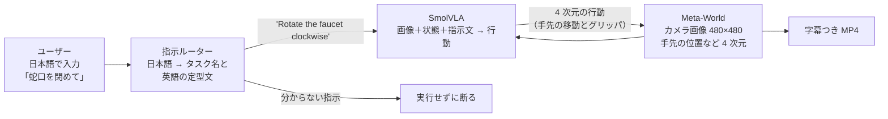
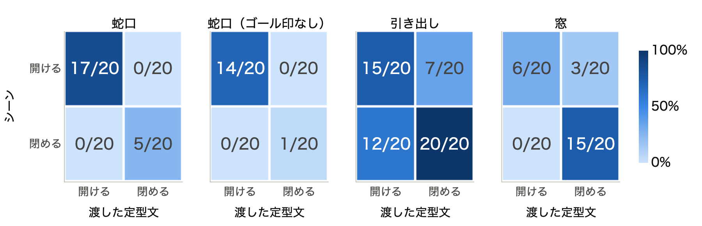
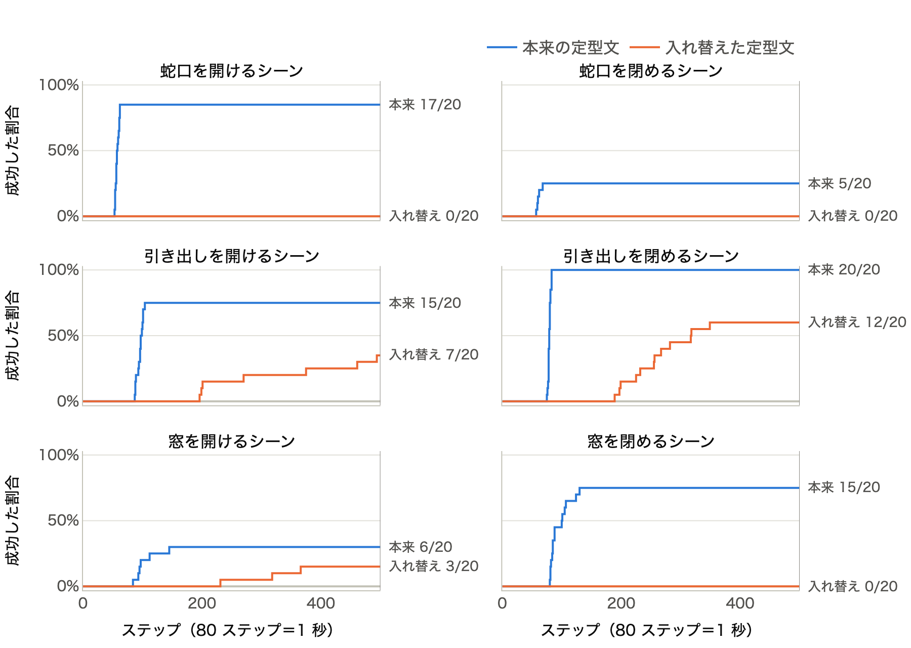
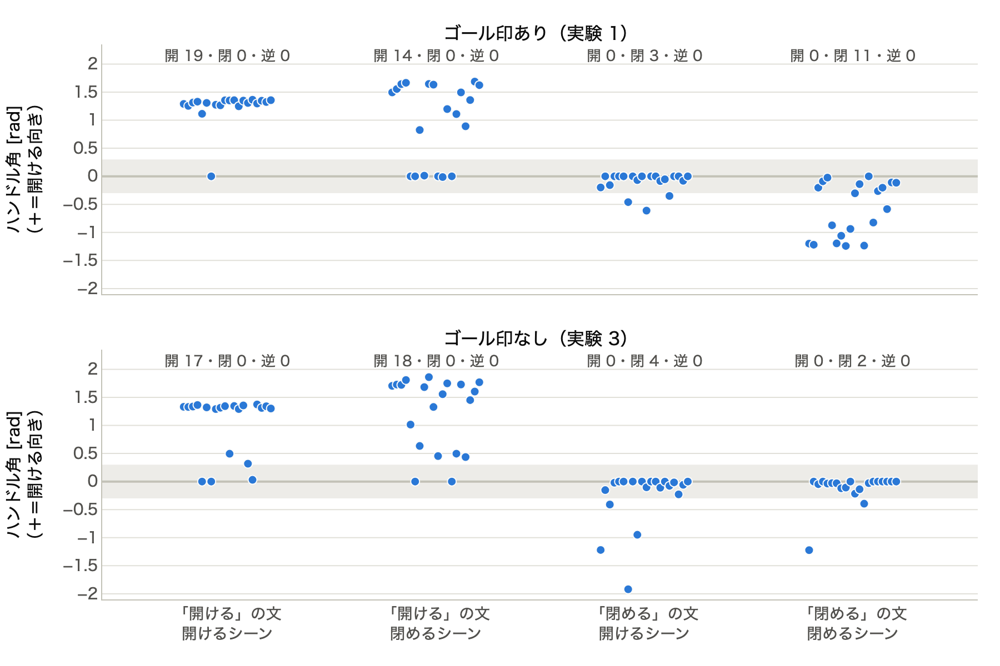
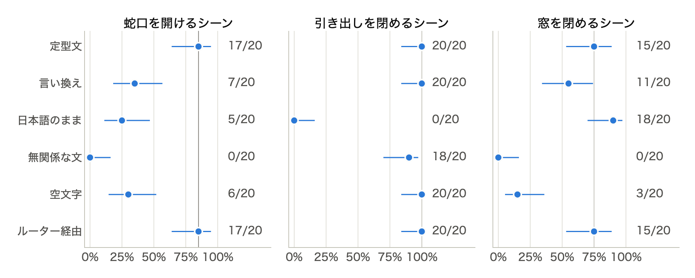

# その指示、ほんとうに聞いてる？

## M1 Mac で動く VLA（SmolVLA × Meta-World）に日本語で指示し、「言葉の効き目」を確かめる

Physical AI 応用1 最終課題レポート　／　動画：<a href="https://youtu.be/IGzcyR98v8M">https://youtu.be/IGzcyR98v8M</a>　／　コード：（GitHub の URL を記入）

## 1. 概要

学習済みの VLA（Vision-Language-Action）モデル SmolVLA [1] を、シミュレータ Meta-World [2] の中で、Apple M1 の Mac 上で動かした。ターミナルに日本語で指示を打つと、指示ルーターが英語の定型文に直して VLA に渡し、ロボットアームが作業する。学習はせず、推論だけで行っている。

そのうえで、「VLA は本当に指示文（言葉）を見て動いているのか、それとも画像だけで作業を決めているのか」を、指示文を入れ替える実験で確かめた。立てた仮説は次の 3 つである。

- **H1**：見た目で作業が分かる組（引き出し・窓）では、指示文を無視しても成功してしまう。
- **H2**：見た目がほぼ同じ組（蛇口を開ける／閉める）では、指示文を入れ替えると成功率が大きく下がる（言葉を使っている）。
- **H3**：日本語の文をそのまま渡すと失敗が増える（学習時の指示文は英語の定型文だけだったため）。

**分かったこと**

1. **言葉は効いている。** 見た目がほぼ同じ「蛇口を開ける／閉める」では、指示文を入れ替えると成功は 0/20 になった。ハンドルを指示と逆向きに回した回は、160 回中 0 回だった。
2. **見た目で作業が分かる場合でも、最初の約 2 秒は言葉が勝つ。** 引き出しは、指示文を入れ替えても 20 回中 12 回はシーンの作業（閉める）を達成した。ただし、成功までの時間は中央値で本来の約 3 倍かかった。入れ替えると、どの作業も最初の約 2 秒では 1 回も成功しなかった。
3. **言葉の効き方は、学習時の英語の定型文に強く依存する。** 日本語をそのまま渡すと、蛇口は 17/20 → 5/20、引き出しは 20/20 → 0/20 に落ちた。ルーターで定型文に直すと元に戻る。

## 2. システム構成

図 0：システム構成。VLA は 50 ステップ分の行動をまとめて推論し（action chunk）、シミュレータは 80 Hz で動く。

| 項目 | 内容 |
|---|---|
| マシン | Apple M1 の Mac。GPU は PyTorch の MPS で利用（CPU への切り替えは不要だった） |
| 環境構築 | uv と Python 3.12（Docker なし） |
| 主なライブラリ | LeRobot 0.5.1 [3]、Meta-World 3.0.0、MuJoCo 3.8.1 [4] |
| モデル | `lerobot/smolvla_metaworld`（Meta-World のデータで学習した SmolVLA。言語・画像部は SmolVLM2 [5]） |
| 速度（実測） | 50 ステップ分の推論 1 回が中央値 457 ms。1 話（最大 500 ステップ）は、成功時に中央値 2.3 秒、失敗時に 9.8 秒。モデルの読み込みは約 16 秒 |

| ファイル | 役割 |
|---|---|
| `src/kotoba_vla/episode.py` | 1 話を実行する（指示文を差し替えられる）。字幕つき MP4 の保存 |
| `src/kotoba_vla/router.py` | 日本語 → タスク名と英語の定型文（キーワード辞書）。分からない指示は断る |
| `src/kotoba_vla/chat.py` | 対話デモ |
| `src/kotoba_vla/experiment.py` | 実験の一括実行と集計（中断しても続きから再開できる） |
| `notebooks/analysis.py` | 分析ノートブック（marimo） |
| `video/` | デモ動画の収録と編集 |

## 3. 工夫した点

### 3.1 Mac で動かすための調査

- SmolVLA の評価によく使われる LIBERO は、依存パッケージ（`hf-libero`）が Linux 専用で Mac に入らない。そこで、同じく学習済みモデルが公開されている Meta-World を選んだ。
- MuJoCo の新しい版（3.17）では Meta-World 3.0.0 が動かないため、3.8.1 に固定した。
- 公式の評価コマンド（`lerobot-eval`）は、カメラ画像の名前の食い違いで止まる。`--rename_map` で名前を付け替えて動作を確認したうえで、自作のスクリプトではモデルに保存された前処理をそのまま使った。

### 3.2 指示文の差し替え

LeRobot の評価ループを自分で書き、観測を前処理したあとのバッチの `task` に任意の文字列を入れるだけで、指示文を差し替えられるようにした（`episode.py` の 1 行）。これにより、定型文・入れ替え・言い換え・日本語・空文字を同じ仕組みで試せる。

### 3.3 公平に比べるための再現性

Meta-World は `reset(seed=...)` の seed を使わず、物の配置を NumPy の乱数で決めていた。そこで、毎話の直前に `np.random.seed(seed)` と `torch.manual_seed(seed)` を呼ぶようにした。これで MPS でも、同じ seed なら完全に同じ結果になる。全条件で seed 0〜19（同じ 20 通りの配置）を共通に使えるので、条件どうしを「同じ配置」で比べられる。

### 3.4 「言葉に従ったか」を測る指標

Meta-World の成功判定はシーンの作業が基準なので、蛇口を閉めるシーンで「開けて」と言われて言葉どおりに開けても「失敗」になる。そこで蛇口では、ハンドル関節の角度（1 話の中で絶対値が最大になったときの値。＋が開ける向き）も記録し、±0.3 rad を超えたら「その向きに回した」と数えた。

### 3.5 見落としやすい手がかりの確認

予備実験（N=10）で、蛇口の 2 シーンは見た目がほぼ同じでも、目標位置を示す小さな印（ゴール印）の奥行きが 5 cm 入れ替わっていると分かった。方策が言葉ではなくこの印で向きを決めている可能性があるため、印を透明にした条件（実験 3）を加えた。

### 3.6 日本語ルーターと「断る」設計

- 日本語の指示から「対象」（蛇口・引き出し・窓・ドア・ボタン）と「動作」（開ける・閉める・押す）をキーワード辞書で探し、9 つの作業のどれかに対応づけて、その作業の英語の定型文を VLA に渡す。ひらがな・半角カナや、「水を出して」「時計回りに回して」のような言い方も拾う。
- 「引き出し」の中の「出し」（＝開ける）や、「反時計回り」の中の「時計回り」（＝閉める）を誤って数えないよう、長いキーワードから順に探し、見つけた部分を伏せてから次を探す。
- 対象や動作が見つからない・複数ある・否定（「〜しないで」）の指示は、実行せずに理由を表示して断る。シーンを固定したデモでは、そのシーンにない物を指す指示（例：蛇口のシーンで「窓を閉めて」）も断る。
- 振る舞いはテスト 23 件で確認した。

## 4. 実験

### 4.1 設定

| 実験 | 内容 | 条件数 |
|---|---|---|
| 実験 1 | 蛇口・引き出し・窓の 3 組で、シーン × 渡す定型文（開ける・閉める）を総当たり | 12 |
| 実験 2 | 蛇口を開ける・引き出しを閉める・窓を閉めるの 3 シーンで、指示文を 6 通りに変える（定型文・言い換え・日本語のまま・無関係な文・空文字・ルーター経由） | 18 |
| 実験 3 | 実験 1 の蛇口を、ゴール印を消して行う | 4 |

- 各条件 20 話（seed 0〜19）。1 話は最大 500 ステップ（80 Hz で 6.25 秒）で、成功は Meta-World の成功判定。
- 重複を除いて 560 話を実行し、M1 Mac で約 67 分かかった。
- 検定は、同じシーンで本来の定型文を渡した条件との比較。Fisher の正確確率検定と、同じ seed どうしを対にした McNemar の検定（正確二項）を、どちらも両側で行い、20 本の検定に Holm の補正 [6] をかけた。成功率の区間は Wilson の 95% 信頼区間。
- 「ルーター経由」はルーターが出す文が定型文そのものなので、定型文の条件と同じ話になる（独立した結果ではない）。

### 4.2 実験 1・3：指示文の入れ替え

<figure>

<figcaption>図 1：指示文の入れ替えテスト。行がシーン（成功判定の基準）、列が渡した定型文。数字は成功数 / 20、色は成功率。「蛇口（ゴール印なし）」は実験 3。</figcaption>
</figure>

- **蛇口**：入れ替えると、開けるシーンで 17/20 → 0/20（Holm 補正後も p<0.001）、閉めるシーンで 5/20 → 0/20 になった。後者は本来の成功率が低く、補正後は有意でない（Fisher p=0.047、補正後 0.38）。
- **引き出し**：入れ替えても、7/20（開けるシーン）と 12/20（閉めるシーン）がシーンの作業を達成した（本来は 15/20 と 20/20）。補正後も差が残るのは閉めるシーンだけ（Fisher、補正後 p=0.034）。
- **窓**：閉めるシーンに「開ける」の文を渡すと 0/20（本来は 15/20、p<0.001）。開けるシーンは本来の文でも 6/20 と低く、判断できない。

<figure class="narrow">

<figcaption>図 2：実験 1 の各条件で、各ステップまでに成功した割合。青が本来の定型文、橙が入れ替えた定型文。</figcaption>
</figure>

本来の定型文の成功は、どのシーンでも 150 ステップ（約 1.9 秒）以内に出そろった。一方、入れ替えたときの成功は最も早くて 189 ステップで、引き出しでは中央値で約 260 ステップかかった。150 ステップで打ち切って数え直すと、本来の定型文の成功は 93 話（実験 1・3 の合計）のまま 1 話も減らず、入れ替えの成功は全組で 0 になる。

<figure class="narrow">

<figcaption>図 3：蛇口のハンドル角（1 点が 1 話）。＋が開ける向き。灰色の帯（±0.3 rad）は「ほとんど回していない」。各列の上の数字は「開ける向き・閉める向き・指示と逆向き」に回した話数。上がゴール印あり（実験 1）、下がゴール印なし（実験 3）。</figcaption>
</figure>

- 指示と逆向きに回した話は 160 話中 0 だった。逆向きに最も大きく回った話でも 0.013 rad（0.7°）なので、しきい値をどこに置いても 0 になる。
- 閉めるシーンに「開ける」の文を渡すと、20 話中 14 話で開ける向きに回した（成功判定上は失敗）。
- ゴール印を消しても、逆向きは 0 のままだった。ただし、閉めるシーンで閉める向きに回せた話は 11/20 → 2/20 に減った（Fisher p=0.006、McNemar p=0.004）。「開ける」はほとんど変わらなかった（19/20 → 17/20）。

### 4.3 実験 2：指示文の言い方

<figure>

<figcaption>図 4：6 種類の文での成功率と 95% 信頼区間。灰色の縦線は定型文の成功率。</figcaption>
</figure>

| 渡した文 | 蛇口を開ける | 引き出しを閉める | 窓を閉める |
|---|---|---|---|
| 定型文 | 17 | 20 | 15 |
| 言い換え（“Turn on the tap” など） | 7 ＊ | 20 | 11 |
| 日本語のまま（「蛇口を開けて」など） | 5 ＊ | 0 ＊ | 18 |
| 無関係な文（“Dunk the basketball into the basket”） | 0 ＊ | 18 | 0 ＊ |
| 空文字 | 6 ＊ | 20 | 3 ＊ |
| ルーター経由（＝定型文） | 17 | 20 | 15 |

表：成功数 / 20。＊は定型文との差が Holm 補正後も p<0.05（Fisher）。

- 日本語のままだと、蛇口と引き出しで大きく下がった。引き出しは空文字でも 20/20 なのに日本語だと 0/20 で、「何も言わない」より悪い。
- 窓だけは日本語のままでも 18/20 成功した。ただし成功までのステップ数は中央値で約 170 と、定型文（88）の約 2 倍だった。
- 文への頼り方はタスクで大きく違う。引き出しは空文字や無関係な文でもほぼ成功し、文をほとんど見ていない。窓は文がないとほとんどできない（無関係な文 0/20、空文字 3/20）。蛇口は言い換えにも弱い（7/20）。

## 5. 考察

- **見た目が同じなら言葉を使う（仮説 H2）は支持された。** 最も強い証拠は成功率よりもハンドルの向きで、言葉が逆なら逆向きに回す。ゴール印を消しても向きは変わらないので、向きを決めているのは言葉である。ただし印を消すと「閉める」動作をやり切れなくなった。動作の実行には印も手がかりにしている可能性がある一方、印のない画像が学習時と違って見えるだけかもしれず、この実験では区別できない。
- **見た目で分かるなら言葉を無視する（仮説 H1）は言いすぎだった。** どの組でも最初の約 2 秒は言葉が行動を左右し、見た目が勝つのは時間をかけたあとの引き出しだけだった。成功率だけを見ると「言葉を入れ替えても 12/20 成功する」と読めてしまうが、成功までの時間を見ると言葉の影響がはっきり出る。見た目だけで解ける作業で VLA の言語理解を評価するときは、成功率だけでなく、成功までの時間や序盤の動きも見る必要がある。
- **日本語のままだと失敗が増える（仮説 H3）は、3 シーン中 2 シーンで支持された。** 日本語が空文字より悪い場合があることから、学習時に見たことのない文は、単に情報がないだけでなく、動作を乱す方向に働きうる。窓だけ日本語でも成功した理由は、今回の実験では分からなかった。
- **実用面**：英語の定型文に強く依存するモデルでは、日本語を定型文に直すルーターが効果的である。また、どう動くか分からない指示（対象が不明、否定など）は実行しないほうが安全である。

## 6. 限界と今後

- シミュレータだけで、1 つのモデル（Meta-World のデータで学習した SmolVLA）だけを調べた。各条件 20 話と少なく、20 話は「20 通りの配置」なので、配置以外のばらつきは含まない。
- ルーターはキーワード辞書なので、辞書にない言い方には対応できない。文の埋め込みを使ったルーターは今回作れなかった。
- 次に確かめたいこと：(1) 意味のない英字列・ローマ字・中国語などでも動作が乱れるか、(2) 窓のシーンに無関係な日本語を渡すとどうなるか、(3) 閉める側のゴール印だけを消すとどうなるか、(4) 引き出しの「遅い成功」の前半で、手先が実際にどちらへ動いているか。
- 言い換えや日本語を含むデータでの追加学習や、SO-101 などの実機での検証も今後の課題である。

## 参考文献

1. M. Shukor et al., “SmolVLA: A Vision-Language-Action Model for Affordable and Efficient Robotics,” arXiv:2506.01844, 2025.
2. T. Yu et al., “Meta-World: A Benchmark and Evaluation for Multi-Task and Meta Reinforcement Learning,” Conference on Robot Learning (CoRL), 2019.
3. R. Cadene et al., “LeRobot: State-of-the-art Machine Learning for Real-World Robotics in Pytorch,” https://github.com/huggingface/lerobot, 2024.
4. E. Todorov, T. Erez, and Y. Tassa, “MuJoCo: A physics engine for model-based control,” IEEE/RSJ IROS, 2012.
5. A. Marafioti et al., “SmolVLM: Redefining small and efficient multimodal models,” arXiv:2504.05299, 2025.
6. S. Holm, “A Simple Sequentially Rejective Multiple Test Procedure,” Scandinavian Journal of Statistics, 6(2), 65–70, 1979.
